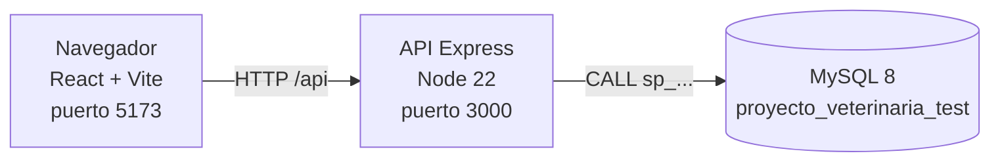
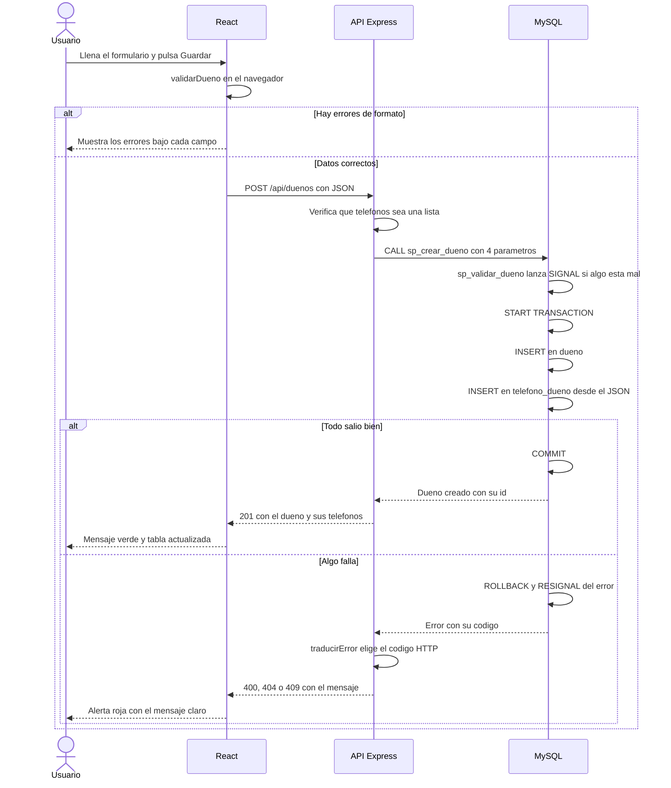

# Documento de arquitectura · Clínica Veterinaria

**Proyecto final de Bases de Datos · Caso 1 · Ingeniería Informática**
**Integrantes:** Tomás Poveda, Juan Esteban Rubio, Isabela Benitez, Cristian Cifuentes y Nicolás Ayala

## 1. Visión general

El sistema tiene tres capas. La regla central del diseño es que **la aplicación nunca escribe SQL de negocio**: toda lectura y escritura pasa por procedimientos almacenados de MySQL.

| Capa | Tecnología | Responsabilidad |
|---|---|---|
| Interfaz | React 19, React Router, React-Bootstrap | Formularios, tablas, mensajes y validación de entrada |
| API | Node 22, Express 5, mysql2 | Recibir peticiones HTTP, validar su forma, llamar procedimientos y traducir errores |
| Base de datos | MySQL 8 | Reglas de negocio, transacciones e integridad de los datos |

En texto plano: navegador (React y Vite) → petición HTTP → API Express → `CALL` → MySQL.

Vite reenvía todo lo que empieza por `/api` al backend (proxy en `vite.config.js`). Así el navegador habla con un solo origen y no hace falta configurar CORS.

## 2. Cómo se conecta la aplicación a la base de datos

- `backend/src/db.js` crea un **pool de conexiones** (hasta 10) con `mysql2/promise`. Las conexiones se reutilizan en lugar de abrir una nueva por cada petición.
- Los datos de conexión (`DB_HOST`, `DB_PORT`, `DB_USER`, `DB_PASSWORD`, `DB_NAME`) salen del archivo `.env`, que **no se sube a Git**. En el repositorio solo está `.env.example`.
- La conexión usa `utf8mb4` (tildes y ñ) y `dateStrings: true`, para que las fechas lleguen como texto `AAAA-MM-DD` y JavaScript no les cambie el día por la zona horaria.
- **Una única función habla con la base: `llamar(procedimiento, parametros)`.** Arma `CALL sp_nombre(?, ?, ...)` con un `?` por cada parámetro. `mysql2` escapa cada valor antes de enviarlo, así que el texto que escribe el usuario nunca se concatena como SQL.
- `llamar` solo acepta nombres que cumplan `^sp_[a-z_]+$`. Si alguien intenta pasar otra cosa, lanza un error antes de tocar la base.
- La única consulta directa de toda la API es `SELECT 1` en `/api/salud`, que comprueba que MySQL responde y no toca ninguna tabla.

- `veterinaria_api@localhost` recibe `EXECUTE` sobre los 22 procedimientos de entrada. MySQL ejecuta el cuerpo con los permisos del definidor. Los permisos directos de lectura, escritura, DDL y las rutinas de demostración quedan reservados a sus respectivas cuentas.

## 3. Flujo de punta a punta: crear un dueño

En texto plano: React valida el formulario y envía el JSON → Express valida los datos y llama al procedimiento → MySQL inserta el dueño y sus teléfonos en una transacción → Express responde con el dueño creado o con el error devuelto tras revertir los cambios.

El mismo recorrido se repite en las demás operaciones, y solo cambian la ruta y el procedimiento. Por ejemplo, `PUT /api/mascotas/5` llama a `sp_actualizar_mascota`.

## 4. Validación en capas: qué se valida dónde y por qué

| Capa | Qué valida | Ejemplos | Por qué aquí |
|---|---|---|---|
| **Frontend** (`src/validaciones/`) | Formato y campos obligatorios, antes de enviar | Nombre de 3 a 50 caracteres, teléfonos de 10 dígitos sin repetir, fecha de nacimiento no futura | Da respuesta inmediata al usuario y ahorra viajes al servidor. **No es seguridad**, porque la API puede llamarse sin la interfaz |
| **API** (`backend/src/`) | La *forma* de lo recibido | `telefonos` es una lista, los ids son enteros positivos, las fechas son `AAAA-MM-DD` y existen de verdad (no el 31 de febrero), el JSON no está dañado | No confía en el cliente y corta lo mal armado antes de llegar a la base |
| **Procedimientos** (`sp_validar_*`) | Reglas de negocio, con `SIGNAL` | Teléfonos de 10 dígitos y sin duplicados, el dueño y la raza existen, no se elimina un dueño con mascotas | Las reglas viven junto a los datos: valen para cualquier cliente que llame al procedimiento |
| **Tablas** (`CHECK`, `NOT NULL`, `UNIQUE`, `FOREIGN KEY`) | Integridad estructural | Costos positivos, un veterinario no puede tener dos citas a la misma fecha y hora, llaves foráneas válidas y supervisor distinto del propio veterinario | Es la última barrera: nada que la rompa puede guardarse, venga de donde venga |

Los límites de longitud (50, 100, 60) son los mismos en el frontend, en los procedimientos y en las columnas, para que un dato aceptado arriba nunca sea rechazado abajo.

## 5. Manejo de errores

Los procedimientos usan `SIGNAL` con códigos propios, y `backend/src/errores.js` los traduce a códigos HTTP. El frontend siempre lee el campo `error` del JSON y lo muestra en una alerta.

| Origen | Código MySQL | HTTP | Ejemplo |
|---|---|---|---|
| `SIGNAL` propio: no existe | 5404 | 404 | «El dueño indicado no existe» |
| `SIGNAL` propio: conflicto | 5409 | 409 | «No se puede eliminar el dueño porque tiene mascotas registradas» |
| `SIGNAL` de validación | 1644 | 400 | «Los teléfonos deben tener 10 dígitos…» |
| Violación de `CHECK`, `NOT NULL`, texto largo o formato | 3819, 1048, 1406, 1292 | 400 | Mensaje genérico claro |
| Duplicado o llave foránea | 1062, 1451, 1452 | 409 | «Ya existe un registro con esos datos» |
| Bloqueo o deadlock | 1213, 1205 | 409 | «Intenta de nuevo» |
| MySQL apagado o clave mala | 1045, 1049, `ECONNREFUSED` | 503 | «No se pudo conectar con la base de datos» |
| Error de formato propio (`ErrorSolicitud`) o JSON dañado | n/a | 400 | «El cuerpo de la solicitud no es un JSON válido» |
| Cualquier otra cosa | n/a | 500 | «Ocurrió un error inesperado»: **los detalles internos solo salen en la terminal del servidor, nunca al usuario** |

## 6. Transacciones

| Procedimiento | Tablas que modifica | Si algo falla |
|---|---|---|
| `sp_crear_dueno` | `dueno` + `telefono_dueno` | `ROLLBACK`: no queda ni el dueño ni sus teléfonos |
| `sp_actualizar_dueno` | `dueno` + `telefono_dueno` (se reemplazan los teléfonos) | `ROLLBACK`: queda como estaba |
| `sp_eliminar_dueno` | `telefono_dueno` + `dueno` | `ROLLBACK`: no se borra nada |
| `sp_registrar_cita_completa` | `cita` + `cita_procedimiento` + `receta` | `ROLLBACK`: no queda la cita ni sus procedimientos ni sus recetas |
| `sp_eliminar_cita` | `receta` + `cita_procedimiento` + `cita` | `ROLLBACK`: la cita se conserva completa |
| `sp_demo_rollback` (script principal) | 3 tablas, la tercera falla a propósito | `ROLLBACK` demostrado: los datos quedan iguales |
## 7. Índices y rendimiento

Para medir el efecto de los índices bajo carga, `backend/scripts/benchmark.js` crea una copia sin índices de la tabla `cita` (`cita_bench`), con **247 citas reales + 20.000 sintéticas = 20.247 filas**. Se usa una copia para no ensuciar los datos reales. Cada consulta se mide con y sin su índice, y el tiempo es la mediana de 20 ejecuciones.

| Consulta | Índice | Sin índice | Con índice | Mejora | Filas leídas |
|---|---|---|---|---|---|
| Citas de un trimestre | `fecha_cita` | 17,92 ms | 1,04 ms | ~17x | 20.429 → 1.705 |
| Agenda de un veterinario en un semestre | `(FK_id_veterinario, fecha_cita)` | 12,87 ms | 0,21 ms | ~61x | 20.429 → 54 |
| Últimas 5 citas de una mascota | `(FK_id_mascota, numero_cita)` | 9,01 ms | 0,16 ms | ~56x | 20.429 → 252 |

**Por qué esas columnas:**
- **`fecha_cita`**: los reportes filtran por rango de fechas. Sin índice, el plan es `ALL` (recorre toda la tabla) y con índice pasa a `range`.
- **`(FK_id_veterinario, fecha_cita)`**: primero va la columna que se compara con `=` y después la del rango. En ese orden MySQL puede usar el índice completo, y además lo recorre sin tocar la tabla (`Using index`).
- **`(FK_id_mascota, numero_cita)`**: filtra por mascota y ya entrega las citas ordenadas, así que desaparece el `Using filesort` y MySQL recorre el índice hacia atrás (`Backward index scan`) y se detiene en 5 filas.
- **No se indexaron `motivo` ni `hora`**: casi nunca se filtra por ellas, y cada índice extra hace más lentos los `INSERT`.

## 8. Pruebas automatizadas

En `backend/`, `npm test` ejecuta las pruebas unitarias y `npm run test:integracion` exige una base de prueba cargada. La suite usa Express y MySQL con los permisos reales de la API.

- Dueños: alta, edición y eliminación, teléfonos inválidos, dueño con mascotas e ID inexistente.
- Citas: alta con detalles, reprogramación con conservación de detalles, eliminación, conflicto de agenda y dosis inválida.
- Atomicidad: el alta falla al intentar guardar una receta para un medicamento inexistente. La prueba verifica que el listado queda igual y que la cita y sus detalles se pueden registrar de nuevo con las mismas claves y horario.
- Privilegios: MySQL rechaza la lectura directa de una tabla y la llamada a una rutina de demostración.

## 9. Decisiones de diseño

| Decisión | Alternativa considerada | Por qué se eligió |
|---|---|---|
| SQL solo en procedimientos almacenados | SQL escrito dentro del código Node | Las reglas viajan con los datos, se pueden probar sin la API y la app queda sin SQL suelto |
| Transacciones dentro del procedimiento | Abrir y cerrar la transacción desde Node | Atomicidad garantizada para cualquier cliente, y se hace una sola llamada de red |
| Teléfonos como lista JSON en una sola llamada | Una llamada por teléfono | Todo ocurre en una sola transacción, y a mitad de camino no puede quedar un dueño sin teléfonos |
| Validación en cuatro capas | Validar solo en la base | Respuesta inmediata en la interfaz, API que no confía en el cliente y base como última barrera |
| `dateStrings: true` | Dejar que mysql2 devuelva objetos `Date` | JavaScript no cambia el día por la zona horaria |
| Benchmark sobre una copia de `cita` | Insertar 20.000 filas en la tabla real | No contamina los datos reales y permite medir «sin índice» de verdad |

## 10. Cómo se ejecuta

El sistema corre **en local**: MySQL, el backend y el frontend en el computador de quien lo usa. Los pasos para cargar el esquema, aprovisionar el usuario de la API y arrancar ambos servidores están en el [README](../README.md).

No se publicó en internet porque el alcance del proyecto es local, y porque una versión pública sin inicio de sesión permitiría que cualquiera cree o borre datos.

## 11. Limitaciones conocidas y mejoras futuras

- **Sin autenticación:** cualquier persona con acceso a la API puede operar sobre los datos.
- **Reprogramar una cita** solo cambia fecha, hora, veterinario y motivo. Los procedimientos y las recetas de una cita ya registrada no se editan; para cambiarlos hay que eliminar la cita y registrarla de nuevo.
- **Las citas no se pueden filtrar** por veterinario ni por fecha desde la interfaz, porque no existe un procedimiento que lo haga.
- **El benchmark mide con 20.247 filas**, un volumen pequeño. Los tiempos absolutos cambiarían con más datos, pero el plan de ejecución (`ALL` frente a `range`/`ref`) es el que explica la diferencia.