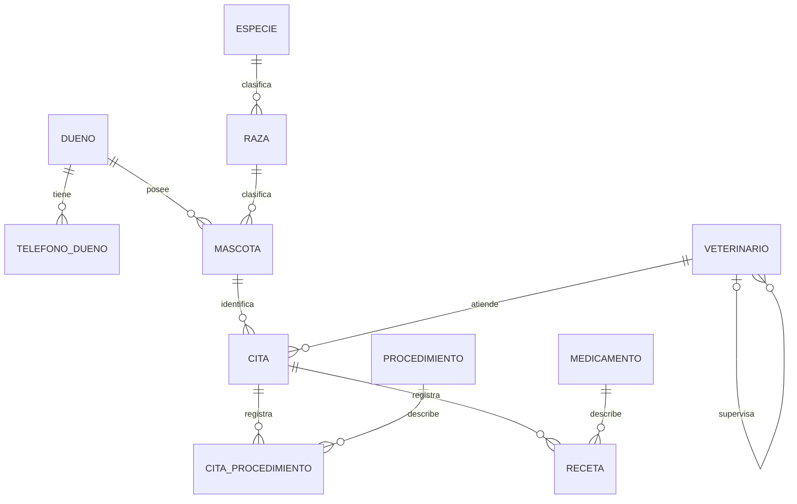

# Modelo relacional de la clínica veterinaria

| Relación | Cardinalidad y claves |
|---|---|
| Dueño → teléfono | 1:N. La clave de un teléfono registrado es el par dueño y número. |
| Dueño → mascota | 1:N. Cada mascota depende de un único dueño. |
| Especie → raza → mascota | 1:N en cada tramo. La raza permite obtener la especie de una mascota. |
| Mascota → cita | 1:N. La cita es una entidad débil identificada por el par mascota y número de cita. |
| Veterinario → cita | 1:N. Cada cita tiene un veterinario. El horario es único por veterinario, fecha y hora. |
| Veterinario → veterinario | Un supervisor puede supervisar a varios veterinarios. Cada veterinario tiene cero o un supervisor distinto de sí mismo. |
| Cita ↔ procedimiento | N:M mediante la entidad asociativa `cita_procedimiento`. Almacena el costo aplicado al procedimiento en esa cita. |
| Cita ↔ medicamento | N:M mediante la entidad asociativa `receta`. Almacena la dosis de ese medicamento en esa cita. |

Los nombres físicos, las claves y las restricciones están en el [script de instalación](../database/proyecto_veterinaria_completo.sql). El gráfico muestra el esquema relacional implementado.
